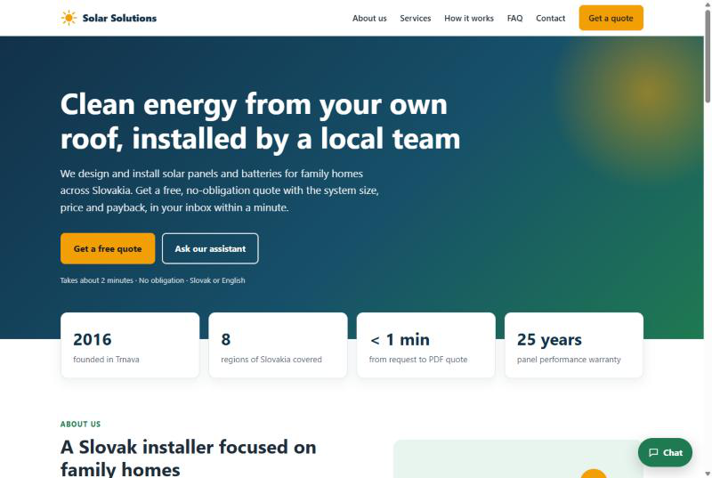
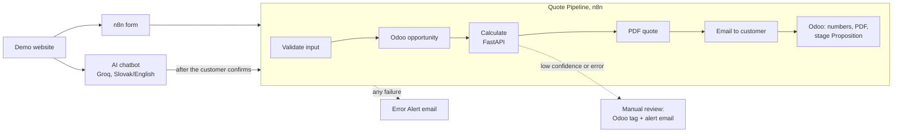

# Solar Sales Automation

An automated lead-to-quote pipeline for a residential solar installer. A customer fills in a form or chats with an
AI assistant, and within about a minute they have a PDF quote in their inbox while the lead, the numbers and the PDF
are already in the CRM.

Built with **n8n**, a **Python / FastAPI** calculator and PDF generator, **Odoo CRM** and an **AI chatbot (Groq)**,
all running locally in Docker. Portfolio project; the installer *Solar Solutions s.r.o.* is fictional.



**[Project overview (one page)](docs/OVERVIEW.md)**: what it does, how it is built and what it saves.

---

## What happens



1. **Entry:** the form or the chatbot collects eight answers: name, email, phone, monthly consumption, roof type,
   orientation, region, battery.
2. **Validate Input** checks every value with fixed rules (allowed options, real email, kWh range; for the chat also
   name + surname and the customer's own confirmation). The language model cannot create a quote from invented data.
3. **Odoo** gets a new opportunity.
4. **Calculator** (`/calculate`) sizes the system from consumption, region yield and roof orientation, prices it and
   computes savings, payback and a confidence score.
5. **PDF** (`/generate-proposal`) is generated and **emailed** to the customer in Slovak.
6. **Odoo** is updated: description with all numbers, expected revenue, PDF attached, stage *Proposition*.
7. Low confidence (< 70 %) or a calculator error → no automatic offer; the lead is tagged *Manual review* and sales
   gets an email. Any other failure → **Error Alert** email with a link to the failed run.

## Stack

| Part | Tool | Where |
|---|---|---|
| Orchestration | n8n (self-hosted) | `Lead Capture.json`, `Quote Pipeline.json`, `AI Chatbot.json`, `Error Alert.json` |
| Calculator + PDF | Python 3.12, FastAPI, ReportLab | `solar_calculator.py`, `proposal_generator.py`, `api_server.py` |
| CRM | Odoo 19 Community + PostgreSQL 15 | `docker-compose.yml` |
| Chatbot | n8n AI Agent + Groq `qwen/qwen3.8-27b` | `AI Chatbot.json` |
| Demo website | plain HTML/CSS, served by the API at `/` | `demo/index.html` |
| Tests | pytest + FastAPI TestClient | `tests/test_api.py` |

## Run it

**Needs:** Docker Desktop (WSL2 on Windows), a free [Groq](https://console.groq.com) API key, and a Gmail account
with an [App Password](https://myaccount.google.com/apppasswords) for sending email.

```powershell
copy .env.example .env      # set POSTGRES_PASSWORD and N8N_ENCRYPTION_KEY (instructions inside)
docker compose up -d --build
```

| Service | URL | First run |
|---|---|---|
| Demo website | http://localhost:8000 | works once the workflows are published |
| Odoo | http://localhost:8069 | create database `solar`, install CRM, create the tag `Manual review`, create an API key |
| n8n | http://localhost:5678 | create the owner account |
| API docs | http://localhost:8000/docs | try `/calculate` |

Then in n8n:

1. Import the workflows: `docker exec solar_n8n n8n import:workflow --input=/backup/workflows.json`
   (or `.\restore.ps1`).
2. Create three credentials in the n8n UI: **Odoo** (URL `http://odoo:8069`, database `solar`, API key),
   **SMTP** (`smtp.gmail.com`, port 465, SSL, Gmail App Password), **Groq** (API key). Select them in the nodes
   that use them.
3. **Publish** Error Alert, Quote Pipeline, Lead Capture and AI Chatbot. In Quote Pipeline → ⋯ → Settings, set
   *Error Workflow* = Error Alert.
4. Open http://localhost:8000 and click **Get a free quote**. Use your own email address.

Inside Docker the containers reach each other by service name: the API is `http://solar_api:8000` and Odoo is
`http://odoo:8069`. `localhost` only works from the browser.

## Tests

```powershell
pip install -r requirements-dev.txt
pytest -v
```

14 tests, no Docker needed: the calculation, input errors (400/422), Slovak region and roof names, battery
"áno", the PDF and the demo page.

## Known limits

- **Groq free tier:** 7,000 input tokens per minute for the whole account. A fast typist or two parallel chats
  can hit it; the chat then shows "Error in workflow". A paid tier fixes it without changing the workflows.
- Prices (1,100 € per kWp, 500 € per kWh of battery, 0.18 €/kWh) and regional yields are starting values at the top
  of `solar_calculator.py`, not real installer data.
- The form and the PDF are in English; the emails and the chat are in Slovak (the chat also in English).
- The alert recipient and the company details are set directly in the workflows and the PDF generator.

## Files

```
demo/index.html        demo website (served at /)
proposal.pdf           sample PDF quote generated by the API
api_server.py          FastAPI: /calculate, /generate-proposal, /download, /health, /
solar_calculator.py    sizing, pricing, ROI, confidence score
proposal_generator.py  ReportLab PDF quote
*.json                 n8n workflows (one file each)
backup/workflows.json  all workflows in one export (used by restore.ps1)
backup.ps1             export workflows, credentials and the Odoo database
restore.ps1            import them on a new machine
docker-compose.yml     postgres, odoo, n8n, solar_api
tests/                 API tests
docs/                  project overview and images
```

`backup/credentials.json` and `backup/odoo.sql` are never committed (`.gitignore`).
